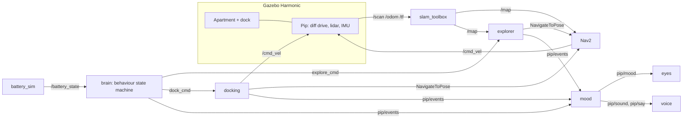

# Pip

[](https://github.com/AfnanDanish/pip-robot/actions/workflows/ci.yml)

A small home robot with a personality. Pip maps your home with a lidar, wanders around on its own,
drives itself back to its charging dock when the battery runs low, and shows how it feels through
two round animated eyes, beeps and a voice. Everything runs locally, with no cloud needed.


The full software stack runs in Gazebo, and the same ROS 2 nodes run on the real robot.

## What Pip does

| | |
|---|---|
| **Maps** | Builds a 2D map of an unknown home with `slam_toolbox` while it drives. |
| **Explores** | Frontier exploration: keeps driving to the edge of the known map until the whole home is mapped. |
| **Navigates** | Nav2 with a regulated pure-pursuit controller, tuned for a 28 cm robot in doorways. |
| **Docks itself** | Drives to a staging pose, finds the dock's face in the lidar scan with RANSAC, lines up with a carrot controller, then creeps the last centimetres on odometry. It retries on a miss. |
| **Manages energy** | Undocks when charged and heads home below 25%. |
| **Has moods** | A mood engine turns robot events (docked, map finished, close call, stuck) into eyes, beeps and short lines. |

## Architecture



| Package | What's in it |
|---|---|
| `pip_description` | Robot model (URDF/xacro) with Gazebo drive, lidar and IMU plugins |
| `pip_gazebo` | Apartment world with furniture and a charging dock, plus the ROS-Gazebo bridge |
| `pip_navigation` | SLAM and Nav2 configuration |
| `pip_brain` | `battery_sim`, `docking`, `explorer`, `brain` and the `pipctl` command-line tool |
| `pip_personality` | `mood` engine, `eyes` (GC9A01-sized round displays) and `voice` (beeps plus Piper or espeak-ng) |
| `pip_bringup` | One launch file that starts everything, plus the RViz layout |

## Run it

You need Ubuntu 24.04, either native or WSL2 on Windows (hardware virtualization must be on in the BIOS).

```bash
# once: install ROS 2 Jazzy, Gazebo Harmonic, Nav2, slam_toolbox (as root)
sudo bash scripts/setup_wsl.sh
# build
bash scripts/build.sh
# go
bash scripts/run_sim.sh            # add headless:=true to skip the Gazebo window
```

Pip starts on its dock, says hello, undocks and starts exploring. Talk to it from another terminal:

```bash
source ~/pip_ws/install/setup.bash
ros2 run pip_brain pipctl hello     # explore | patrol | dock | stop | sleep | wake | hello
ros2 run teleop_twist_keyboard teleop_twist_keyboard   # drive it yourself
```

## Tests

The logic is plain Python, so it's tested without ROS. The tests include a closed-loop docking test:
a simulated robot and lidar run through the real controller from four bad starting poses.

```bash
pip install numpy pytest && pytest
python scripts/render_eyes.py      # regenerate docs/eyes.png (needs pygame)
```

CI runs those tests and builds and tests every package in a ROS 2 Jazzy container.

## Hardware

Parts list, wiring and the Pi-to-microcontroller protocol: [docs/hardware.md](docs/hardware.md).

## License

MIT
