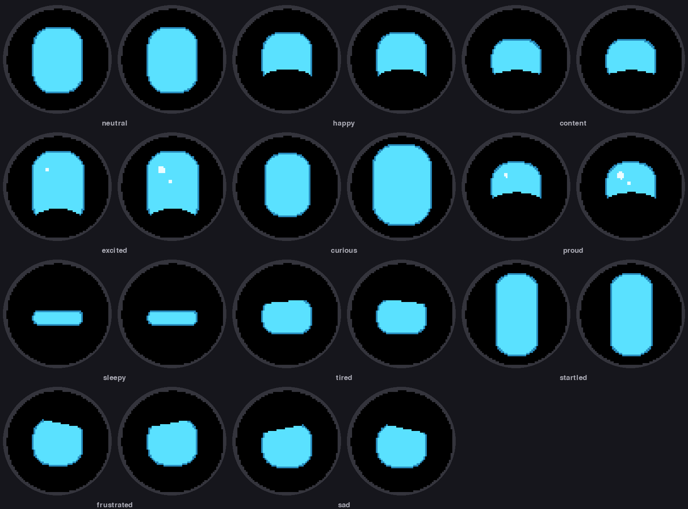

# Pip

[](https://github.com/AfnanDanish/pip-robot/actions/workflows/ci.yml)

Pip is a small home robot I'm building. It wakes up on its charger, maps the place with a lidar,
wanders around, and when the battery gets low it drives home and plugs itself back in. It has two
round screens for eyes and talks mostly in beeps.

Right now Pip lives in simulation while I save up for parts. The code here is the real thing,
though: the same ROS 2 nodes will run on the robot.

**[Watch it run in your browser →](https://afnandanish.github.io/pip-robot/)**

Things to try there: drop a box in front of it, click somewhere on its map to send it off, poke it,
or put it to sleep. The numbered dots are developer commentary, and each one explains a decision.



## Why it's built the way it is

[docs/build-notes.md](docs/build-notes.md) is the long version: why two computers instead of one,
why a lidar and not a camera, why wheels and not treads (that one hurt), how docking works, and a
running list of things that have gone wrong. If you read one file in this repo, read that one.

The parts list is in [docs/hardware.md](docs/hardware.md).

## What's in here

```
src/
  pip_description    the robot: body, wheels, lidar, IMU, as URDF
  pip_gazebo         a small apartment with furniture and a charging dock
  pip_navigation     slam_toolbox + Nav2, tuned for a 28 cm robot in 90 cm doorways
  pip_brain          battery, docking, exploration, and the state machine that decides what to do
  pip_personality    moods, the eyes, beeps and speech
  pip_bringup        one launch file that starts all of it
web/                 the browser version (no build step, plain JS)
docs/                build notes, parts list, eye contact sheet
```

Roughly how the pieces talk:

```
lidar, odometry ──► slam_toolbox ──► map ──► explorer ──┐
                                              │          ├──► Nav2 ──► wheels
battery ──► brain ──► "go explore" / "go home" ┘          │
                 └──► docking (lidar line fit) ──────────┘
everything ──► pip/events ──► mood ──► eyes, beeps, the odd sentence
```

## Running the ROS version

Fair warning: I haven't launched this in Gazebo on my own machine yet (my BIOS had virtualization
switched off, so WSL couldn't run Linux). CI builds and tests every package inside a ROS 2 Jazzy
container, but the first real launch will probably need a fix or two.

On Ubuntu 24.04, natively or under WSL2:

```bash
sudo bash scripts/setup_wsl.sh   # ROS 2 Jazzy, Gazebo Harmonic, Nav2, slam_toolbox
bash scripts/build.sh
bash scripts/run_sim.sh          # headless:=true skips the Gazebo window
```

Then, from another terminal:

```bash
source ~/pip_ws/install/setup.bash
ros2 run pip_brain pipctl hello   # or explore, patrol, dock, sleep, wake, stop
```

## Tests

Most of the logic is plain Python, so it's tested without ROS:

```bash
pip install numpy pytest pyyaml && pytest
```

The one I trust most is `test_docking_loop.py`. It puts a simulated robot in front of a simulated
dock with a simulated lidar, starting from four bad positions, and runs the real docking controller
until it would hand over to the final creep. If that test passes, the geometry is right.

There's also a config test that checks that the spawn point, the dock's position in the world and
the docking code's contact distance all agree, because those live in three different files and
drift apart silently.

## License

MIT
